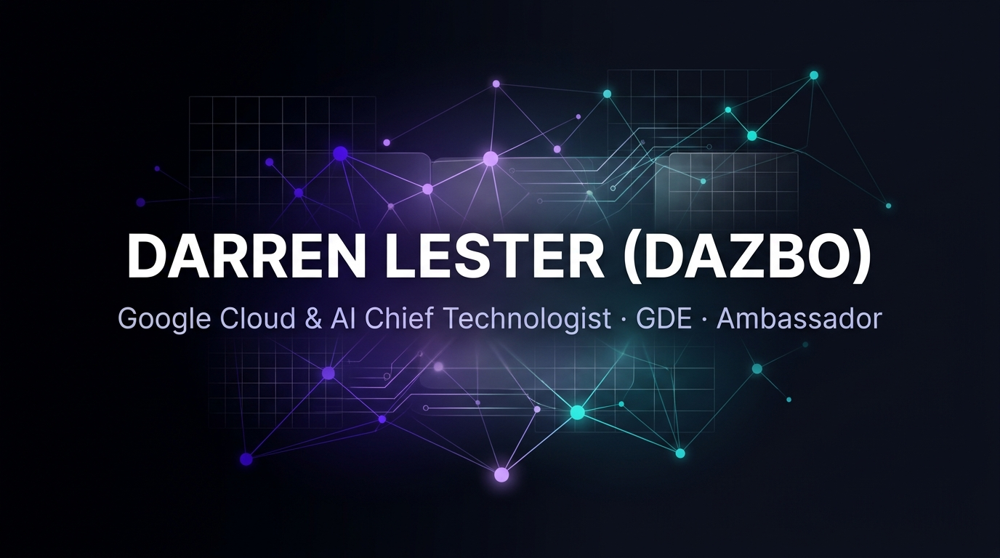

 

&nbsp;&nbsp;&nbsp;&nbsp;&nbsp;&nbsp;

&nbsp;&nbsp;

 

&nbsp;&nbsp;

---

### 🚀 About Me

I help organisations design and adopt **Google Cloud** and **Agentic AI** at enterprise scale — from cloud strategy, landing zones, and FinOps to autonomous coding harnesses, MCP tooling, and production Gemini/ADK agents.

- 🔭 **Current Focus**: Harness Engineering, Agent Skills, Google Agent Development Kit (ADK), Gemini CLI / Antigravity workflows, and Google Cloud Architecture.
- 🎤 **Speaking & Community**: Google Cloud Next '26 Speaker & GDE Studio Creator, Google Cloud Ambassador (~40 globally), and Partner All-Star.
- 📝 **Writing**: Deep-dive tutorials and architectural guides on [darrenlester.net/blogs](https://darrenlester.net/blogs), [Medium](https://medium.com/@dazbo), and [Dev.to](https://dev.to/dazbo).

---

### 🛠️ Core Stack

&nbsp;&nbsp;&nbsp;&nbsp;&nbsp;&nbsp;&nbsp;&nbsp;&nbsp;&nbsp;&nbsp;&nbsp;

---

### ⭐ Featured Repositories

| Project | What It Does | Stack / Highlights |
| :--- | :--- | :--- |
| **[dazbo-agent-skills](https://github.com/derailed-dash/dazbo-agent-skills)** | Reusable agentic skills for AI coding assistants (TDD, Spec-Driven Development, Docs Maintenance, Tiered Rubric Loops) | Agent Skills, Markdown, Python |
| **[gcp-billing-killswitch](https://github.com/derailed-dash/gcp-billing-killswitch)** | Automated GCP budget-alert billing killswitch that detaches billing to prevent runaway cloud spend | GCP, Cloud Functions, FinOps |
| **[gemini-review-action](https://github.com/derailed-dash/gemini-review-action)** | Automated PR code review & issue triage GitHub Action with full codebase context powered by Gemini | GitHub Actions, Gemini API |
| **[agentic-ui-testing](https://github.com/derailed-dash/agentic-ui-testing)** | Google Developer Codelab for automated UI testing with Gemini CLI, BrowserMCP, and Playwright | Gemini CLI, MCP, Playwright |
| **[smart-gcp-finops](https://github.com/derailed-dash/smart-gcp-finops)** | Agentic FinOps solution for GCP practitioners to analyse and optimise spend across an organisation | Google ADK, A2UI, GCP |
| **[harness-engineering-demo](https://github.com/derailed-dash/harness-engineering-demo)** | Interactive workbench comparing unharnessed vibe coding vs autonomous harnessed agent loops ([Live Demo](https://harness-engineering.darrenlester.net/)) | Google ADK, Gemini, FastAPI |
| **[dazbo-portfolio](https://github.com/derailed-dash/dazbo-portfolio)** | My portfolio site & Gemini ADK assistant powering [darrenlester.net](https://darrenlester.net/) | Python, FastAPI, React, Firestore |
| **[rickbot-adk](https://github.com/derailed-dash/rickbot-adk)** | Multi-personality chatbot built with Google ADK and Gemini on Cloud Run ([Live Demo](https://rickbot.co.uk)) | Google ADK, Gemini, Cloud Run |

---

### 🔗 Elsewhere

- 🌐 **Portfolio & AI Assistant**: [darrenlester.net](https://darrenlester.net/)
- 🐍 **Python & Advent of Code Walkthroughs**: [aoc.just2good.co.uk](https://aoc.just2good.co.uk/)
- ☁️ **GCP Challenge Labs**: [derailed-dash.github.io/gcp-challenge-labs](https://derailed-dash.github.io/gcp-challenge-labs/)
- 📫 **Email**: [real.dazbo@gmail.com](mailto:real.dazbo@gmail.com)
