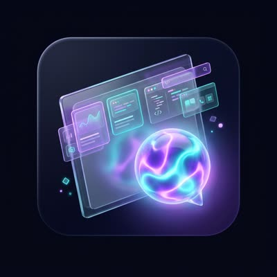

 

&nbsp;&nbsp;&nbsp;&nbsp;

&nbsp;&nbsp;&nbsp;&nbsp;

 

&nbsp;&nbsp;

---

### 👋 About Me

Hi folks! I'm Darren (aka **Dazbo**). By day I'm a **Google Cloud & AI Chief Technologist**, **Google Developer Expert (GDE)**, and **Google Cloud Ambassador**. Outside of that, I just love tinkering with Google products and AI, learning new things, and sharing the journey.

- 🧪 **What I'm playing with**: **Gemini**, **Google Antigravity**, **ADK**, **Harness Engineering**, **MCP**, and **Google Cloud** — building autonomous agentic workflows, FinOps tools, and coding harnesses.
- 🎤 **Speaker, Tech Blogger & Creator**: Sharing what I learn through conference talks (Google Cloud Next '26 Speaker & GDE Studio Creator), videos, and deep-dive walkthroughs on [darrenlester.net/blogs](https://darrenlester.net/blogs), [Medium](https://medium.com/@dazbo), and [Dev.to](https://dev.to/dazbo).

---

### 🛠️ Core Stack

&nbsp;&nbsp;&nbsp;&nbsp;&nbsp;&nbsp;&nbsp;&nbsp;&nbsp;&nbsp;&nbsp;&nbsp;

---

### ⭐ Featured Repositories

<table>
  <tr>
    <td width="50%" align="center" valign="top">
      
       
      <strong><a href="https://github.com/derailed-dash/dazbo-agent-skills">dazbo-agent-skills</a></strong>
       
      Agent Skills · Markdown · Python
      
Reusable agentic skills for AI coding assistants (TDD, Spec-Driven Development, Docs Maintenance, Tiered Rubric Loops).

    </td>
    <td width="50%" align="center" valign="top">
      
       
      <strong><a href="https://github.com/derailed-dash/gcp-billing-killswitch">gcp-billing-killswitch</a></strong>
       
      GCP · Cloud Functions · FinOps
      
Automated GCP budget-alert billing killswitch that detaches billing to prevent runaway cloud spend.

    </td>
  </tr>
  <tr>
    <td width="50%" align="center" valign="top">
      
       
      <strong><a href="https://github.com/derailed-dash/gemini-review-action">gemini-review-action</a></strong>
       
      GitHub Actions · Gemini API
      
Automated PR code review &amp; issue triage GitHub Action with full codebase context powered by Gemini.

    </td>
    <td width="50%" align="center" valign="top">
      
       
      <strong><a href="https://github.com/derailed-dash/agentic-ui-testing">agentic-ui-testing</a></strong>
       
      AI Agents · MCP · Playwright
      
Google Developer Codelab for automated UI testing with AI agents, BrowserMCP, and Playwright.

    </td>
  </tr>
  <tr>
    <td width="50%" align="center" valign="top">
      
       
      <strong><a href="https://github.com/derailed-dash/smart-gcp-finops">smart-gcp-finops</a></strong>
       
      Google ADK · A2UI · GCP
      
Agentic FinOps solution for GCP practitioners to analyse and optimise spend across an organisation.

    </td>
    <td width="50%" align="center" valign="top">
      
       
      <strong><a href="https://github.com/derailed-dash/harness-engineering-demo">harness-engineering-demo</a></strong>
       
      Google ADK · Gemini · FastAPI
      
Interactive workbench comparing unharnessed vibe coding vs autonomous harnessed agent loops (<a href="https://harness-engineering.darrenlester.net/">Live Demo</a>).

    </td>
  </tr>
  <tr>
    <td width="50%" align="center" valign="top">
      
       
      <strong><a href="https://github.com/derailed-dash/dazbo-portfolio">dazbo-portfolio</a></strong>
       
      Python · FastAPI · React · Firestore
      
My portfolio site &amp; Gemini ADK assistant powering <a href="https://darrenlester.net/">darrenlester.net</a>.

    </td>
    <td width="50%" align="center" valign="top">
      
       
      <strong><a href="https://github.com/derailed-dash/rickbot-adk">rickbot-adk</a></strong>
       
      Google ADK · Gemini · Cloud Run
      
Multi-personality chatbot built with Google ADK and Gemini on Cloud Run (<a href="https://rickbot.co.uk">Live Demo</a>).

    </td>
  </tr>
</table>

---

### 🔗 Elsewhere

- 🌐 **Portfolio & AI Assistant**: [darrenlester.net](https://darrenlester.net/)
- 🐍 **Python & Advent of Code Walkthroughs**: [aoc.just2good.co.uk](https://aoc.just2good.co.uk/)
- 📫 **Email**: [real.dazbo@gmail.com](mailto:real.dazbo@gmail.com)
